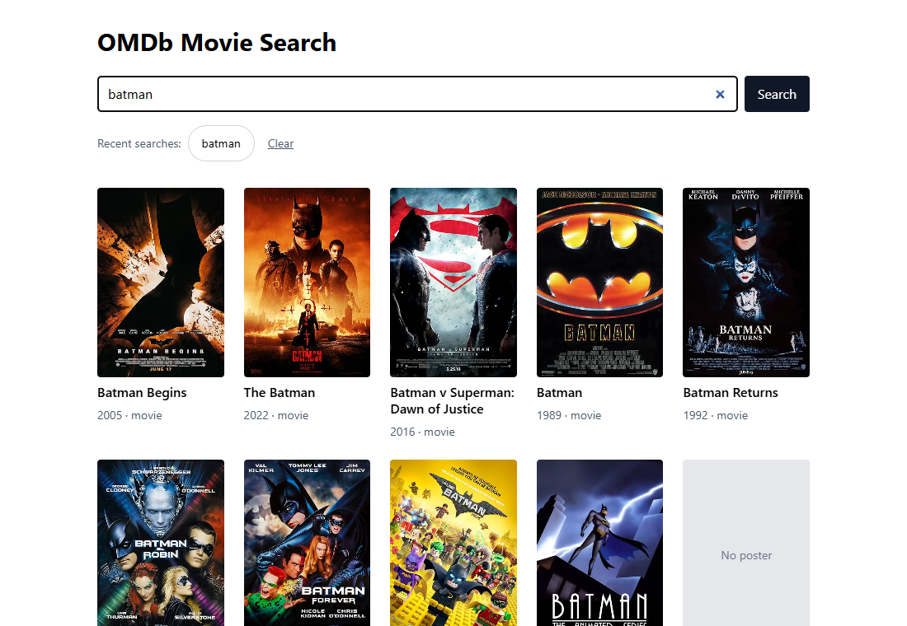

# OMDb Movie Search

Search movies by title, browse the results, and open the details of a movie. The app remembers your last five searches.

Laravel 13 (PHP 8.5) serves a JSON API in front of the [OMDb API](https://www.omdbapi.com/). A Vue 3 + TypeScript page talks only to that API, never to OMDb directly.



## Features

- Search by title, with paging (OMDb returns 10 results per page).
- Results as cards with poster, title, year and type. A placeholder is shown when a movie has no poster or the image fails to load.
- Details window: poster, plot, IMDb rating with votes, other ratings, genres, director, writers, actors, runtime, awards and a link to IMDb.
- The last five searches are kept (newest first, no duplicates, survives a page reload). Click one to run it again, or clear the list.
- Clear messages for the start screen, loading, no results, "too many results", and service errors.
- Keyboard friendly: the details window closes with Esc, keeps Tab inside, and returns focus to the card. The layout works down to a 360 px wide screen.

## Requirements

- PHP 8.5.12 or newer and [Composer](https://getcomposer.org/). `composer.json` asks for this version, and an older PHP stops at start-up with a clear message. 8.5.12 is the first 8.5 release with the October 2026 security fixes (two critical remote-code-execution bugs, also fixed in 8.2.35, 8.3.36 and 8.4.27). The tests were run on PHP 8.5.12, and CI runs them on 8.5.
- Node.js 22.12 or newer (Vitest 5 asks for it; Vite 8 alone needs 20.19+)
- A free OMDb API key: <https://www.omdbapi.com/apikey.aspx>

SQLite is used for sessions and the cache, so no database server is needed.

## Setup

```bash
git clone <repository-url>
cd omdb-movie-search

composer install
cp .env.example .env            # Windows cmd: copy .env.example .env
php artisan key:generate        # creates Laravel's own APP_KEY in .env (see below)

php -r "touch('database/database.sqlite');"   # creates the empty SQLite file
php artisan migrate

npm install
```

Then open `.env` and set your OMDb key by hand:

```
OMDB_API_KEY=your-key
```

There are two different keys, and only one of them is generated for you:

- `APP_KEY` is Laravel's secret for encrypting cookies and sessions. `php artisan key:generate` creates it.
- `OMDB_API_KEY` is your access key for OMDb. Nothing can generate it: request a free key at <https://www.omdbapi.com/apikey.aspx>, confirm it by email, and paste it into `.env`. Without it every search fails with "The movie service is not configured correctly."

`php artisan migrate` stops with an error if the SQLite file does not exist yet, so create it first.

## Run it

Use two terminals:

```bash
php artisan serve     # the app and the API, http://localhost:8000
npm run dev           # Vite, serves the frontend files with hot reload
```

Open **http://localhost:8000** (not the Vite address, `localhost:5173`).

Without `npm run dev` you can build the frontend once with `npm run build` and run only `php artisan serve`. Remember to run the build again after you change the frontend, because the built files are not updated by themselves.

## Tests and checks

| Command | What it does |
|---------|--------------|
| `php artisan test` | PHP unit and feature tests |
| `npm test` | Vue component, composable and App tests (Vitest, jsdom) |
| `npm run typecheck` | TypeScript check of the whole frontend (`vue-tsc`) |
| `npm run lint` | ESLint |
| `npm run format:check` | Prettier check (`npm run format` fixes files) |
| `./vendor/bin/pint --test` | PHP code style check (without `--test` it fixes files) |

No test calls the real OMDb. PHP tests use `Http::fake()`, and the frontend tests replace the network with a fake API.

A GitHub Actions workflow (`.github/workflows/ci.yml`) runs the PHP checks (`pint --test`, `php artisan test`) and the frontend checks (`typecheck`, `lint`, `format:check`, `test`, `build`) on every push to `main` and on every pull request.

## API

All routes are under `/api`.

| Method and path | Description |
|-----------------|-------------|
| `GET /api/movies?q=batman&page=1` | Search by title. `q` is required (max 100 characters), `page` is 1 to 100. Returns `data` (movies) and `meta` (`page`, `total`, `per_page`, `last_page`). A successful search with results on page 1 is added to the history. |
| `GET /api/movies/{imdbId}` | Details of one movie. The id looks like `tt0372784` (`tt` and 7 to 10 digits); anything else is a 404 that never reaches OMDb. |
| `GET /api/history` | The last five search texts of this browser session, newest first. |
| `DELETE /api/history` | Clears that list. |

Errors are JSON, `{"message": "..."}`, with a fitting status: 404 not found, 422 invalid input or too many results, 429 request limit reached, 502 OMDb not reachable, 504 OMDb too slow to answer, 500 missing or invalid API key.

## How it is built

```
Vue 3 page  --->  Laravel API  --->  OMDb
 (browser)       (OmdbClient)
                 (SearchHistory, session)
```

```
app/Services/Omdb/            OmdbClient, OmdbException, OmdbErrorKind
app/Services/SearchHistory.php
app/Http/Controllers/Api/     MovieController, HistoryController
app/Http/Requests/            SearchMovieRequest (validation)
app/Http/Resources/           MovieSummaryResource, MovieDetailsResource (the JSON shape)
routes/api.php, routes/web.php
resources/js/
    api/client.ts             the only code that sends requests
    composables/              useMovieSearch, useMovieDetails, useSearchHistory
    components/               SearchForm, MovieList, MovieCard, PosterImage, PaginationNav,
                              StatusMessage, SearchHistory, MovieDetailsModal
    types/movie.ts            the shape of the API answers
```

## Decisions and trade-offs

- **Laravel sits between the browser and OMDb.** The API key never reaches the browser, OMDb's odd answers are cleaned up in one place (most errors arrive as HTTP 200 with `"Response": "False"`, missing values are the text `"N/A"`, lists are one comma-separated string, votes contain commas), and the frontend gets stable, typed JSON.
- **Caching.** Search answers are cached for 10 minutes and movie details for 24 hours, so repeated requests do not use up the daily OMDb limit. An empty search result is cached, and an id that does not exist is remembered for 10 minutes. Other failures are not cached, so a short outage does not stick.
- **Timeouts and retries.** Connecting to OMDb may take 5 seconds and a whole request 10. Requests are tried a second time after network errors, timeouts and 5xx answers, never after a plain "not found". A request that is still too slow ends in a 504 with its own message. The limits are generous on purpose: on the machine where this was built, PHP 8.2 and 8.3 needed 1.4 to 2 seconds per OMDb request, while PHP 8.5 and the `curl` command needed about 0.3, and a 5 second limit was once not enough. The slow PHP builds came with OpenSSL 3.0 and the PHP 8.5 build with OpenSSL 3.5; whether that is the cause was not confirmed.
- **History lives in the session.** No accounts and no table of their own, which fits a small app. The price: it belongs to one browser, and it disappears when the session cookie is cleared or expires (`SESSION_LIFETIME` is 30 days in `.env.example`). The history routes and the search route run in Laravel's `web` middleware group, because that is what starts the session. Because `DELETE` changes data, it needs the CSRF token; Axios sends it from the `XSRF-TOKEN` cookie.
- **What counts as a search in the history:** the first page of a search that found at least one movie. Paging, empty results and errors are not recorded. Recording happens in the controller, so answers served from the cache count too.
- **Stale answers are ignored on the frontend.** Starting a new search or opening another movie cancels the previous request (`AbortController`), so a slow old answer cannot overwrite a newer one.
- **Composables take their dependencies as parameters.** Tests pass in fakes, so there is no need for module mocking.
- **Paging stops at page 100,** which is what the API accepts. If moving to another page fails, the results of the current page stay on screen and a message says so.
- **Request limits.** The API routes allow 60 requests a minute per client, and the history routes have a limit of their own. This protects against a single noisy client, not against many clients together using up the daily OMDb quota.

## Known limitations

- Entries that OMDb sends without a usable title or id (missing, empty, blank or `"N/A"`) are skipped in search results, and the details endpoint answers 502 for them. Other fields are shown as they come.
- OMDb answers `"Error getting data."` for an id that does not exist. The app treats that as "not found", so a genuine glitch with the same text would also look like a 404.
- The history is kept in the session, and sessions do not lock. Two requests of the same browser that run at the same moment can overwrite each other's session data, so a search is occasionally missing from the history. This follows from how Laravel sessions work. It was not reproduced, because `php artisan serve` handles one request at a time. Locking the session would make a slow OMDb block the next request of the same visitor, which seemed worse.
- Search is by title only. OMDb can also filter by year and type; this app does not use that.
- The frontend tests run in jsdom, not in a real browser. The layout was checked by hand in Chrome at 360 px and 1280 px, and nowhere else.
- Returning focus to the card after closing the details window relies on the clicked button having focus. Some browsers (Safari, as far as I know) do not focus buttons on click, so there the focus would not return. Keyboard use is not affected.
- `npm audit` reports moderate advisories in development tools (`minimatch`, used by ESLint and the test tooling). They do not ship with the app.

## Running it for real

The `.env.example` is meant for local work. For a real deployment set at least `APP_ENV=production` and `APP_DEBUG=false`. With debug on, error responses contain file paths and stack traces; with it off they contain only the message (checked with a test). Behind HTTPS also set `SESSION_SECURE_COOKIE=true`, so the session cookie is never sent over plain HTTP.

## What could come next

- Filters for year and type, and a link that opens the details of a movie directly.
- Browser end-to-end tests, for example with Playwright.
- Docker or Sail for a one-command setup.
